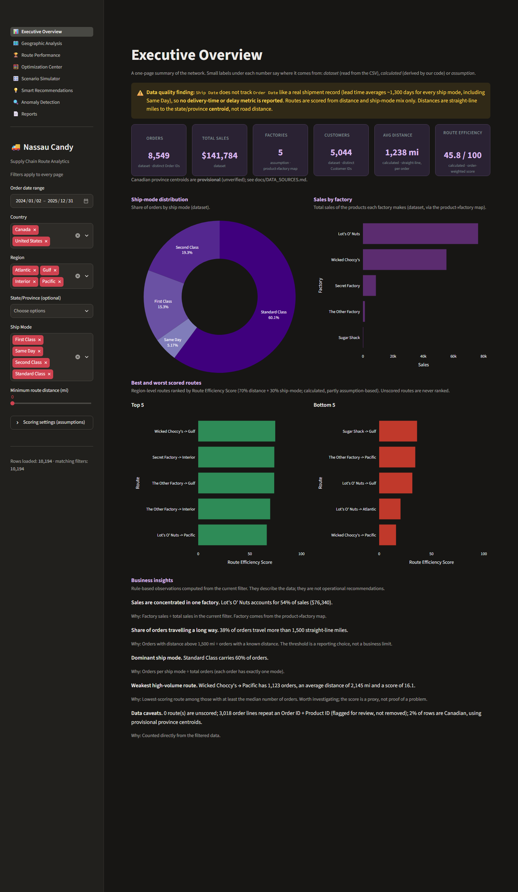

# Nassau Candy Distributor — Supply Chain Route Analytics

A local Streamlit dashboard that analyses factory-to-customer shipping routes for a candy distributor. It scores routes by distance and ship-mode mix, runs a clearly labelled **hypothetical** factory-allocation simulation with Google OR-Tools, flags data anomalies, generates explainable recommendations, and exports PDF, Excel and CSV reports.



## Read this first: data limitations
- **`Ship Date` is unusable.** It does not track `Order Date` (about 1,300 days for every ship mode, including Same Day), so **no delivery-time or delay metric is reported anywhere**. Routes are scored from distance and ship-mode mix only.
- Distances are **straight-line miles to state/province centroids**, not road distances or customer addresses. Canadian province centroids are **provisional**.
- The dataset has **no factory column, shipping cost or capacity data.** The product-to-factory map comes from the project brief.
- The optimizer is a **what-if simulation**, never an operational recommendation. Estimated costs appear only when you enter a rate, and are never actual costs.

Details: [docs/DATA_SOURCES.md](docs/DATA_SOURCES.md).

## What it does
| Page | Purpose |
|---|---|
| **Executive Overview** | KPIs (each labelled dataset / calculated / assumption), ship-mode and factory charts, best and worst routes, rule-based insights with a "why" line |
| **Geographic Analysis** | Factory-to-state/province map (US and Canada), distance comparison, shipment density and bottleneck flags |
| **Route Performance** | Route Efficiency Score leaderboard with the score broken into its parts, unscored routes listed separately, ship-mode comparison, state/province drill-down |
| **Optimization Center** | Hypothetical allocation of demand to the nearest eligible factory (GLOP), optional hypothetical capacities, existing-vs-proposed comparison, optional illustrative cost, CSV exports with explicit split lines |
| **Scenario Simulator** | Compare 2 to 4 hypothetical scenarios against the existing allocation |
| **Smart Recommendations** | Rule-based prompts to investigate, each with its reason, rule and supporting values |
| **Anomaly Detection** | IQR route outliers, duplicate lines, missing geography, price/profit patterns, factory-product patterns; flags only, nothing is deleted |
| **Reports** | PDF report, 9-sheet Excel workbook and CSV exports, with timestamp and scenario assumptions |

Screenshots of every page are in [docs/screenshots/](docs/screenshots/). How to use each page: [docs/USER_GUIDE.md](docs/USER_GUIDE.md).

## Installation and running
Tested on **Python 3.12 and 3.14**. Older Python versions were not tested, so none is claimed to work.

**Windows shortcut:** double-click or run `setup_env.bat` once (creates `.venv` and installs `requirements.txt` into it), then `run_app.bat` to start the dashboard. `run_app.bat` refuses to start unless the project's own `.venv` exists and contains the required packages, and it always launches Streamlit with `.venv\Scripts\python.exe`. Extra Streamlit options can be appended, for example `run_app.bat --server.port 8502`.

**Manual steps (any platform):**
```bash
# 1. create and activate a virtual environment (inside the project folder)
python -m venv .venv
.venv\Scripts\activate            # Windows        (macOS/Linux: source .venv/bin/activate)

# 2. install the dependencies
pip install -r requirements.txt

# 3. start the dashboard (from the project folder)
python -m streamlit run app.py    # opens http://localhost:8501

# 4. run the tests
python -m pytest
```
- **Always use the project's own environment, never a global or temporary Python.** Install with `.venv\Scripts\python.exe -m pip install -r requirements.txt` and start with `.venv\Scripts\python.exe -m streamlit run app.py` (macOS/Linux: `.venv/bin/python`). `.vscode/settings.json` makes VS Code select `.venv` automatically.
- **Use `python -m streamlit run app.py`** (with the project's `.venv` active) rather than a bare `streamlit` command: it guarantees Streamlit runs under the same Python that has the packages installed. If the app is started under a Python that lacks a required package, it now shows a clear "Missing Python packages" message naming that Python and the fix. After editing code, **stop and restart the server**: a long-running Streamlit process keeps old copies of helper modules.
- **Start the app from the project folder.** The CSV is found relative to the code, so the app also works from elsewhere, but Streamlit reads `.streamlit/config.toml` (which hides the Deploy button) only from the folder you start it in.
- **Data file.** `Nassau_Candy_Distributor.csv` must sit in the project folder. If it is missing, empty or has the wrong columns, the dashboard shows a plain explanation of what is wrong and how to fix it instead of a traceback.
- `python route_core.py` is a small command-line export of the processed tables (written to the current folder, git-ignored).

## Tested environments
The full test suite (268 tests) was run on the final code in four environments, each with the result **268 passed**. The three fresh environments were built from `requirements.txt` alone.

| Environment | Python | streamlit | pandas | numpy | plotly | ortools | openpyxl | reportlab | pytest | pyarrow | Result |
|---|---|---|---|---|---|---|---|---|---|---|---|
| Development `.venv` | 3.14.6 | 1.67.0 | 3.1.1 | 2.5.4 | 7.1.0 | 9.15.6755 | 3.1.5 | 5.1.0 | 9.2.0 | 26.0.1 | 268 passed (116 s) |
| Fresh install, newest packages | 3.14.6 | 1.67.0 | 3.1.1 | 2.5.4 | 7.1.0 | 9.15.6755 | 3.1.5 | 5.1.0 | 9.2.0 | 26.0.1 | 268 passed (122 s) |
| Fresh install, newest packages | 3.12.8 | 1.67.0 | 3.1.1 | 2.5.4 | 7.1.0 | 9.15.6755 | 3.1.5 | 5.1.0 | 9.2.0 | 26.0.1 | 268 passed (106 s) |
| **Oldest supported versions** | 3.12.8 | 1.50.0 | 2.1.1 | 1.26.0 | 5.18.0 | 9.9.3963 | 3.1.0 | 4.0.0 | 8.0.0 | 17.0.0 | 268 passed (87 s) |

- The lower bounds in `requirements.txt` are exactly the "oldest" row. **Older versions were not tested** (pandas 2.0 and numpy 1.24 cannot be installed on Python 3.12), so no compatibility with them is claimed.
- If you stay on numpy 1.x, install `pyarrow==17.0.0`: the newest pyarrow requires numpy 2 or newer (a mismatch fails with `pyarrow requires NumPy 2.0 or newer`).
- The application was also started from an unrelated folder and answered HTTP 200 with a healthy `/_stcore/health`; all 8 pages were captured fully rendered in a real browser, and every download button was clicked and its file checked (see `docs/screenshots/capture_report.json`).

## Repository structure
```
run_app.bat               Windows launcher: starts the app with the project's .venv (checks packages first)
setup_env.bat             Windows setup: creates .venv and installs requirements.txt into it
.vscode/settings.json     VS Code uses the project's .venv interpreter
app.py                    navigation shell (entry point)
route_core.py             data loading and validation, reference tables, haversine, route summaries
config.py                 editable score weights and ship-mode assumptions
modules/                  pure logic (no Streamlit): scoring, route_analysis, optimization, scenarios,
                          anomaly_detection, recommendations, reporting
ui/                       Streamlit helpers: common (filters, tables), charts, scenario_controls
views/                    the 8 dashboard pages
utils/report_generator.py Excel (OpenPyXL), PDF (ReportLab) and CSV writers
tools/                    optional developer tool: full-page screenshots + download tests
tests/                    268 pytest tests
docs/                     documentation and screenshots
.streamlit/config.toml    hides the Deploy button
.github/workflows/        CI configuration (never run; see below)
Nassau_Candy_Distributor.csv   source data (never modified)
```

## Documentation
| Document | For |
|---|---|
| [docs/USER_GUIDE.md](docs/USER_GUIDE.md) | Using the dashboard page by page |
| [docs/METHODOLOGY.md](docs/METHODOLOGY.md) | How every number is calculated, with worked examples |
| [docs/PROJECT.md](docs/PROJECT.md) | Architecture, data-flow and optimization diagrams, tests, impact map, limitations, future work |
| [docs/INTERVIEW_PREPARATION.md](docs/INTERVIEW_PREPARATION.md) | Presentation outline and viva questions with answers |
| [docs/DATA_SOURCES.md](docs/DATA_SOURCES.md) | Data provenance and limitations |
| [docs/SUGAR_SHACK_INVESTIGATION.md](docs/SUGAR_SHACK_INVESTIGATION.md) | Why one factory's sales look tiny |

## Known limitations (short list)
Straight-line distances to centroids; provisional Canadian centroids; assumed score weights and ship-mode suitability; hypothetical eligibility and capacities in the optimizer; heuristic anomaly and recommendation thresholds; Excel files verified by reading them back (not by opening Excel). The full list and the future improvements are in [docs/PROJECT.md](docs/PROJECT.md).

## Continuous integration
`.github/workflows/tests.yml` runs `pytest` on Python 3.12 when the project is hosted on GitHub. **It has not been run** (the project has not been pushed anywhere); its YAML syntax was checked locally. The same suite was run locally in fresh virtual environments, listed above.
