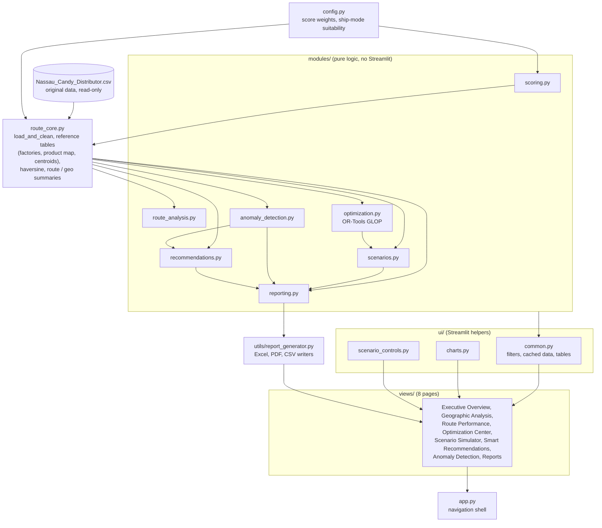
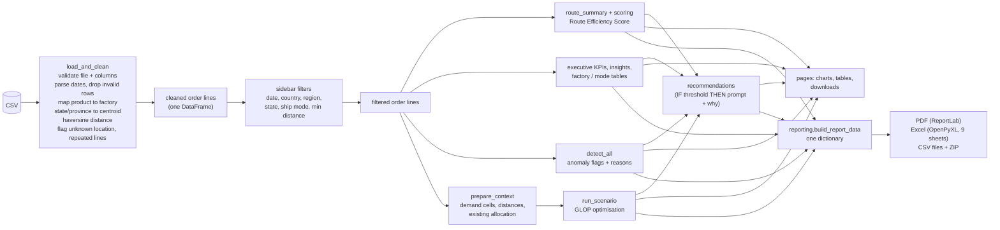
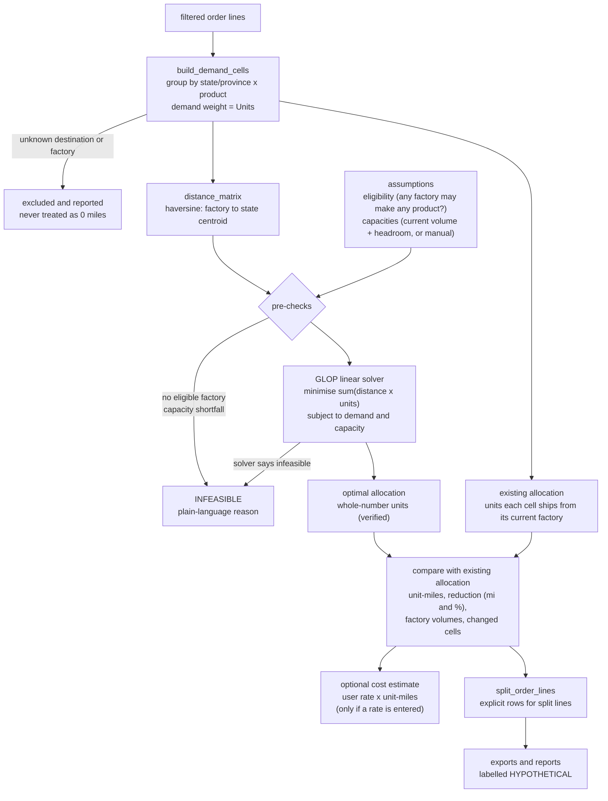

# Nassau Candy Route Analytics: developer notes

**What it is.** An 8-page Streamlit dashboard over pandas analysis code. It uses a 10,194-row sales CSV ([Nassau_Candy_Distributor.csv](../Nassau_Candy_Distributor.csv), never modified). It scores factory-to-destination routes by straight-line distance and ship-mode mix, runs a *hypothetical* factory-allocation simulation (OR-Tools GLOP), flags anomalies, generates explainable recommendations, and exports PDF, Excel and CSV reports.
**Run:** see [README.md](../README.md). **Test:** `python -m pytest` (268 tests).
Last verified: 2026-11-09, end of Phase 5. Tags: [ran] executed, [read] static inspection.
Related: [METHODOLOGY.md](METHODOLOGY.md) (how every number is calculated), [USER_GUIDE.md](USER_GUIDE.md), [INTERVIEW_PREPARATION.md](INTERVIEW_PREPARATION.md), [DATA_SOURCES.md](DATA_SOURCES.md), [SUGAR_SHACK_INVESTIGATION.md](SUGAR_SHACK_INVESTIGATION.md).

## 1. System architecture

**Dependency rule.** Arrows point from "provides" to "uses". Streamlit code lives only in `app.py`, `ui/` and `views/`; every calculation lives in `route_core.py` and `modules/`, so it can be tested without a browser.
**Known layering note (documented, not restructured).** `route_core.py` imports `modules/scoring.py`, while the other modules import `route_core.py`. There is **no import cycle today** [read, verified by inspecting imports]: `scoring.py` imports only `config.py`. A cycle would appear only if `scoring.py` ever imported `route_core.py`; keep it that way, or move the reference tables to their own module first.

## 2. Data flow

## 3. Optimization workflow (hypothetical simulation)

## 4. Layout
| Path | Role |
|---|---|
| `app.py` | Entry point only: page config, sidebar title, `st.navigation` over `views/` |
| `views/*.py` (8) | One script per page |
| `ui/common.py` | CSS, cached data (with friendly data-file errors), sidebar filters (fixed widget keys), scoring settings, `scored_routes`, `show_table` |
| `ui/environment.py` | Startup check: required packages present in the running Python, else a clear fix message (imports nothing heavy) |
| `ui/charts.py`, `ui/scenario_controls.py` | Map figure; the reusable scenario form (widget keys prefixed `sim0_`, `rec_`, `rep_`) |
| `route_core.py` | Data loading and validation, reference tables, haversine, route/geo/ship-mode summaries |
| `config.py` | Editable assumptions: score weights, ship-mode suitability |
| `modules/` | `scoring`, `route_analysis`, `optimization`, `scenarios`, `anomaly_detection`, `recommendations`, `reporting` |
| `utils/report_generator.py` | Writes Excel, PDF and CSV from the report data |
| `tools/capture_screenshots.py` | Optional developer tool: full-page browser screenshots and real download tests |
| `.streamlit/config.toml` | Hides the toolbar's Deploy button |
| `run_app.bat`, `setup_env.bat`, `.vscode/settings.json` | Launch workflow: install into and start from the project's `.venv` only (checks the environment first); VS Code interpreter setting |
| `tests/` | 268 pytest tests (table in section 8) |
| `.github/workflows/tests.yml` | CI configuration. **Never run** (the repository has not been pushed) |

## 5. Data facts
- [ran] 10,194 rows, 8,549 orders, 5,044 customers, 15 products, 59 states/provinces (9,994 US rows, **200 Canadian rows**). Each order has exactly one ship mode, factory, state and customer (a test enforces this).
- [ran] **Ship Date is unusable** (about 1,300 days for every mode): no time metric is reported.
- [ran] 3,018 lines (1,373 groups) repeat an Order ID + Product ID; 396 of them are identical in every compared value. Flagged, never removed.
- [ran] Every product has one constant unit price and margin.
- The CSV has no factory column, no shipping cost, no capacity and no customer coordinates (see DATA_SOURCES.md).
- Sugar Shack's tiny sales are a characteristic of the data (96.6% of lines are chocolate), not evidence of a mapping error: [SUGAR_SHACK_INVESTIGATION.md](SUGAR_SHACK_INVESTIGATION.md).

## 6. Audit findings and status
| # | Finding | Status |
|---|---|---|
| 1 | 200 Canadian rows lost under default filters | **Fixed** (Canadian centroids added; NaN-safe filter) |
| 2 | Unscored routes appeared as "least efficient" | **Fixed** (unscored routes excluded and listed separately) |
| 3 | 40% of the score was an unvalidated assumption | **Addressed**: 70/30, configurable, labelled as assumptions |
| 4 | Pie chart used text as values | **Fixed** |
| 5 | README listed missing files | **Fixed** (README rewritten in Phase 5) |
| 6 | No tests or CI | **268 tests pass** [ran]; CI **configured but never run** |
| 7 | CSV path depended on the current folder; raw crash if missing | **Fixed**: path resolved from the project folder; friendly `DataFileError` for a missing, empty, unreadable or wrong-column file |
| 8 | Empty input crashed the scoring step | **Fixed** (found by a Phase 5 regression test) |
| 9 | Tables showed only ~10 rows without saying so; counts without thousands separators; duplicated Cell column; truncated anomaly reasons | **Fixed** (`show_table`, page changes) |
| 10 | Deploy button visible | **Hidden** via `.streamlit/config.toml` (nothing is deployed) |
| 11 | Unused imports, dead function, duplicate constant | **Removed** (`ship_mode_by_route_level`, 10 imports, duplicate `LONG_DISTANCE_MILES`) |
| 13 | The running app used a temporary scratch Python (no ortools) instead of the project `.venv` | **Fixed.** Cause: the only launch path was an ad-hoc command started on the first working session. No project file, IDE or Claude setting referenced it. Added `run_app.bat`, `setup_env.bat`, `.vscode/settings.json`, README/USER_GUIDE instructions and 7 tests (`test_launch.py`); the scratch environment was deleted |
| 12 | App showed `No module named 'ortools'` and `cannot import name 'DataFileError' / 'US_STATE_ABBREVIATIONS' from 'route_core'` | **Not a code defect.** The server on port 8501 had been running since before Phase 5 from an old scratch virtual environment that never had ortools, openpyxl or reportlab, and it held a stale in-memory copy of `route_core`. All 181 local imports across 39 files resolve [ran]. **Hardened:** `ui/environment.py` + `app.py` now show a clear "Missing Python packages" message naming the interpreter and the fix; README and USER_GUIDE troubleshooting updated; 8 tests |

## 7. Tested environments (exact versions) [ran]
All four runs executed the full suite on the final code: **268 passed** each.

| Environment | Python | streamlit | pandas | numpy | plotly | ortools | openpyxl | reportlab | pytest | pyarrow | Time |
|---|---|---|---|---|---|---|---|---|---|---|---|
| Development `.venv` | 3.14.6 | 1.67.0 | 3.1.1 | 2.5.4 | 7.1.0 | 9.15.6755 | 3.1.5 | 5.1.0 | 9.2.0 | 26.0.1 | 116 s |
| Fresh install from `requirements.txt` | 3.14.6 | 1.67.0 | 3.1.1 | 2.5.4 | 7.1.0 | 9.15.6755 | 3.1.5 | 5.1.0 | 9.2.0 | 26.0.1 | 122 s |
| Fresh install from `requirements.txt` | 3.12.8 | 1.67.0 | 3.1.1 | 2.5.4 | 7.1.0 | 9.15.6755 | 3.1.5 | 5.1.0 | 9.2.0 | 26.0.1 | 106 s |
| **Oldest supported versions** | 3.12.8 | 1.50.0 | 2.1.1 | 1.26.0 | 5.18.0 | 9.9.3963 | 3.1.0 | 4.0.0 | 8.0.0 | 17.0.0 | 87 s |

Lower bounds in `requirements.txt` equal the last row. **Not tested:** Python below 3.12, pandas below 2.1.1, numpy below 1.26 (older versions cannot be installed on Python 3.12). With numpy 1.x the newest pyarrow fails ("requires NumPy 2.0 or newer"), so pair numpy 1.x with pyarrow 17.x. While validating the lower bounds, the first oldest-version run failed for exactly that reason (an environment mismatch, not a code defect); after installing pyarrow 17.0.0 it passed.

**Application startup [ran]:** `streamlit run` from the project folder and from an unrelated folder both returned HTTP 200 and a healthy `/_stcore/health`. **GitHub Actions has not been run.**

## 8. Tests
| File | Tests | Covers |
|---|---|---|
| test_distance, test_pipeline, test_route_summary | 6 + 7 + 10 | haversine, loading, unscored-route handling, the one-mode-per-order assumption |
| test_scoring | 24 | normalisation, weights, missing-value rules, worked example |
| test_route_analysis, test_geo_helpers | 10 + 7 | KPIs, insights, map table, IQR-style thresholds, map figure |
| test_optimization | 44 | worked example, constraints, infeasible cases, integrality, order-line splits |
| test_scenarios | 14 | scenario engine, locks and exclusions, cost columns |
| test_anomaly_detection | 17 | IQR, duplicates, geography, sales/profit, factory-product |
| test_recommendations | 10 | each rule family and its explanation fields |
| test_reports | 26 | Excel sheets and formats, PDF text, CSV files, labelling, infeasible reports |
| test_app_smoke | 25 | all 8 pages under interaction (filters, scenarios, report generation) |
| test_launch | 7 | launch workflow: scripts use the project `.venv`, run script really starts Streamlit and refuses to start without `.venv`, VS Code setting, no reference to a temporary interpreter |
| test_environment | 8 | startup check: missing-package message, requirements consistency, normal start unaffected |
| test_robustness | 53 | CSV hash and mapping guards, data-file errors, loading from any folder, 9 edge subsets, all pages with "matches nothing" and "Canada only" filters, config and requirements |

## 9. Impact map (what a change can break)
- `load_and_clean` output columns (`Factory`, `Route Distance (mi)`, `Route (Factory-*)`, `Missing Geo`, `Repeated Order-Product Line`, `Country/Region`, `Customer Lat/Lon`) are used by every module and page. `tests/test_pipeline.py`, `test_robustness.py` and `test_app_smoke.py` cover the main paths.
- `route_summary` returns the score in a column still named **"Route Efficiency Proxy Score"** (historical name); reports and the executive page display it as "Route Efficiency Score". It excludes unscored routes by default.
- `config.py` values change every ranking. `STATE_CENTROIDS` (US + provisional Canada) is the single source of destination coordinates.
- `modules/optimization.py` depends on `route_core.FACTORIES`, `haversine_miles`; the cell = state × product convention is covered by tests.
- Widget keys (`f_*`, `w_distance`, `suit_*`, `opt_*`, `sim*_`, `rec_*`, `rep_*`, `geo_*`) are used by the tests; renaming them breaks `test_app_smoke.py` / `test_robustness.py`.
- `REQUIRED_COLUMNS` in `route_core.py` must match what the code reads.
- Streamlit reads `.streamlit/config.toml` from the folder you start it in, so start the app from the project folder to hide the Deploy button.

## 10. Known limitations
- **Data:** Ship Date unusable; no factory, cost, capacity or customer-coordinate data; product→factory map comes from the project brief and cannot be verified from the CSV; constant prices and margins.
- **Geography:** straight-line distance to state/province centroids (not road distance or addresses); **Canadian centroids are provisional** (no authoritative source found; a 100-mile error moves a score by at most 1.4 points).
- **Scoring:** weights and ship-mode suitability are assumptions; scores are relative to the longest route.
- **Optimizer:** hypothetical; "any factory can make any product" is an assumption; without capacity limits the result is an upper bound that overloads small factories; the line-level allocation is a bookkeeping rule.
- **Heuristics:** anomaly and recommendation thresholds are fixed constants, not business rules.
- **Verification gaps:** Excel output was verified by reading it back with OpenPyXL, not by opening Excel; **GitHub Actions has never run**; no coverage figure was measured; Python below 3.12 untested.
- **Dev server:** Streamlit's hot reload re-runs page scripts but keeps old copies of already-imported helper modules; **restart the server after changing any file other than a page** (`route_core.py`, `ui/`, `modules/`, `utils/`). This caused the Phase 5 "cannot import name" errors on a long-running server.

## 11. Future improvements
1. Obtain a real factory × product eligibility table and capacities, then replace the hypothetical assumptions.
2. Add shipping-cost data and road distances (a routing service) to replace straight-line proxies.
3. Verify province centroids against NRCan or Statistics Canada boundary files, or use population-weighted points.
4. Run CI on GitHub and add a coverage report.
5. Move the reference tables out of `route_core.py` into their own module and split the long writer functions.
6. Investigate the 396 likely duplicate lines with the data owner.
7. Add per-user saved scenarios (a small database) if the simulator becomes a shared tool.

## 12. Change history
| Phase | Summary |
|---|---|
| 1 | Canadian centroids, unscored-route handling, pie chart fix, data-quality flags, tests, README correction |
| 2 | 70/30 configurable scoring, multi-page navigation, Executive Overview, Geographic Analysis |
| 3 | OR-Tools GLOP allocation simulation, Optimization Center, Sugar Shack investigation |
| 4 | Scenario Simulator, anomaly detection, recommendations, PDF/Excel/CSV reports |
| 5 | Project-relative CSV path and friendly data errors, robustness tests, UI fixes (table heights, thousands separators, reasons, labels), cleanup, Deploy button hidden, dependency lower bounds tested, full-page screenshots with real download tests, complete documentation |

The original CSV and `PRODUCT_FACTORY_MAP` are guarded by tests (`test_original_csv_is_byte_for_byte_unchanged`, `test_product_to_factory_mapping_is_unchanged`).

## Maintaining this file
Update only the sections a change affects, re-check file references before relying on them, keep the findings table as the single record of issues, and keep the diagrams in sync with the code.
